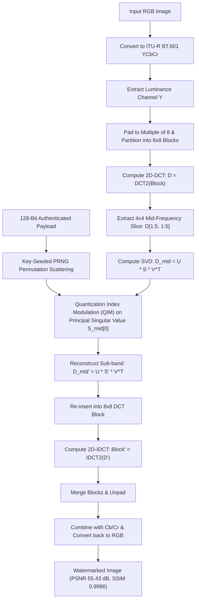

# CreditMera: A Robust Image Watermarking and Ownership Verification System Using DCT-SVD

> **"Your Image. Your Credit."**  
> *An International Image Ownership, Watermarking, Verification, and Attribution Platform.*

**Academic Degree:** Bachelor of Technology (B.Tech) in Computer Science & Engineering (CSE)  
**Author:** Harshita Jain  
**Repository:** [https://github.com/HarshitaJAIN1401/CreditMera](https://github.com/HarshitaJAIN1401/CreditMera)  
**Local Project Path:** `E:\CreditMera project dip\CreditMera`  
**Current Platform Version:** 1.0.0 (Core Engine v2.4 / Algorithm `v1.0-dct-svd`)  

---

## 1. Executive Summary & Problem Statement

In the era of rapid digital media distribution and generative AI, creative photographers, visual artists, agencies, and publishers face unprecedented intellectual property challenges:
- **Visible Watermarks:** Trivially removed via modern AI inpainting tools and crop operations; destroy the aesthetic and commercial value of high-resolution photography.
- **EXIF / Metadata Stripping:** Major social media and content sharing platforms (Instagram, X/Twitter, WhatsApp) automatically discard metadata upon upload to conserve bandwidth and protect privacy.
- **Fragile Spatial Watermarking (LSB):** Readily wiped out by standard lossy compression (such as JPEG), format conversions, or minor image scaling.
- **Lack of Cryptographic Proof:** Traditional watermarks lack tamper-resistant cryptographic binding between the creator’s identity, registration timestamp, and the image payload.

**CreditMera** solves this crisis by combining **frequency-domain Digital Image Processing (DCT)** and **matrix decomposition (SVD)** with modern **applied cryptography (HMAC-SHA256, CRC-16, and canonical digital receipts)**. It embeds an imperceptible, tamper-evident 128-bit watermark into the mid-frequency singular values of the luminance channel, enabling **blind extraction**, **cryptographic verification**, and **dual-layer perceptual similarity detection**.

---

## 2. Platform Architecture & Directory Structure

```text
CreditMera/
├── .env.example                      # Development configuration template
├── .env.production.example           # Production environment reference template
├── .gitignore                         # Strict exclusion rules (secrets, datasets, cache)
├── docker-compose.yml                 # Multi-container production stack orchestration
├── README.md                          # Primary platform and evaluation documentation
├── backend/                           # Python FastAPI service & DIP Watermarking Engine
│   ├── app/
│   │   ├── api/v1/                    # RESTful API routers (auth, assets, verify, similarity, cases)
│   │   ├── core/                      # Security utilities (PBKDF2, JWT HS256, HMAC, config)
│   │   ├── db/                        # PostgreSQL session and connection pooling
│   │   ├── models/                    # SQLAlchemy 2.0 ORM database models
│   │   ├── schemas/                   # Pydantic v2 data validation schemas
│   │   ├── services/                  # Registration, job workers, and verification logic
│   │   └── main.py                    # FastAPI application entry point, CORS, and probes
│   ├── watermark/                     # Core DIP watermarking and perceptual similarity engine
│   │   ├── dct.py                     # Independent baseline 2D-DCT implementation
│   │   ├── svd.py                     # Independent baseline spatial SVD implementation
│   │   ├── dct_svd.py                 # Hybrid DCT-SVD with QIM on mid-frequencies
│   │   ├── transforms.py              # ITU-R BT.601 YCbCr color conversion & 8x8 block splitting
│   │   ├── payload.py                 # 128-bit payload encoder/decoder (CRC-16 + HMAC-32)
│   │   ├── similarity.py              # DIP similarity engine (64-bit pHash, dHash, SSIM)
│   │   └── metrics.py                 # Mathematical metrics (PSNR, SSIM, NC, BER)
│   ├── verification/                  # Blind forensic extraction & 5-tier ownership matching
│   ├── storage/                       # Storage provider abstraction (Sandboxed Local & S3)
│   ├── alembic/                       # Declarative database migrations
│   ├── tests/                         # 141 automated pytest unit & integration tests
│   ├── Dockerfile                     # Production container image definition
│   └── requirements.txt               # Backend dependencies
├── frontend/                          # React 18 + TypeScript + Vite + Tailwind CSS SPA
│   ├── src/
│   │   ├── components/                # 8 core workspaces & 4 interactive modals
│   │   │   ├── DashboardTab.tsx       # KPI overview & live creator assets
│   │   │   ├── ProtectTab.tsx         # 4-step guided embedding & registration wizard
│   │   │   ├── VerifyTab.tsx          # Blind watermark extraction & DIP similarity
│   │   │   ├── AssetVaultTab.tsx      # Personal digital depository & pHash lookup
│   │   │   ├── PassportModal.tsx      # Certified digital provenance passport & PDF print
│   │   │   ├── RobustnessLabTab.tsx   # 336-trial empirical benchmark laboratory
│   │   │   ├── GlobalCasesTab.tsx     # International misuse dossiers & timeline notes
│   │   │   ├── ReceiptVerifyTab.tsx   # Public standalone HMAC receipt verification
│   │   │   ├── Navbar.tsx             # Global search, language selector, notifications
│   │   │   ├── Sidebar.tsx            # Collapsible navigation with RTL mirroring
│   │   │   └── AuthModal.tsx          # Sign In & Account Registration modal
│   │   ├── i18n/                      # Internationalization engine (186 keys x 7 languages)
│   │   │   ├── translations.ts        # Typed dictionaries (EN, HI, ES, FR, DE, JA, AR)
│   │   │   └── I18nContext.tsx        # Reactive language provider with HTML dir="rtl" sync
│   │   └── services/api.ts            # Typed Axios HTTP client with Bearer auth handling
│   ├── tests/                         # 24 automated Vitest frontend tests
│   ├── nginx.conf                     # Production reverse proxy, caching, and security headers
│   └── Dockerfile                     # Multi-stage production container build
├── experiments/                       # Scientific evaluation suite & benchmark corpus
│   ├── datasets/sources/              # Benchmark images (gradient, texture, naturalistic, non-square)
│   ├── robustness/                    # Automated attack harness (JPEG, resize, blur, noise, crop, rot)
│   └── results/                       # Empirical benchmark results (robustness_results.json, .csv)
└── docs/                              # Major project evaluation documentation & reports
    ├── DIP_ALGORITHM_AND_IMPLEMENTATION.md      # DIP formulas, pseudocode, and mathematical details
    ├── FINAL_TEST_AND_REPRODUCIBILITY_REPORT.md # Test logs, container verification, reproducibility
    ├── FINAL_SECURITY_REVIEW.md                 # Vulnerability review and multi-tenant security
    ├── PROJECT_ABSTRACT.md                      # Academic abstract, motivation, and objectives
    ├── PROJECT_ARCHITECTURE.md                  # Three-tier architecture & Mermaid diagrams
    ├── MODULE_DESCRIPTION.md                    # Detailed software module specification
    ├── PROJECT_LIMITATIONS_AND_FUTURE_SCOPE.md  # Scientific limitations and research roadmap
    ├── PROJECT_DEMO_GUIDE.md                    # Step-by-step 8–10 minute demonstration guide
    ├── PROJECT_VIVA_QUESTIONS.md                # 65 technical viva questions and answers
    ├── PROJECT_PRESENTATION_CONTENT.md          # 15-slide presentation outline and speaker script
    └── SUBMISSION_CLEANUP_RECOMMENDATIONS.md    # Packaging and submission cleanup guidelines
```

---

## 3. Key Features & Platform Workspaces

1. **Protect & Embed (`ProtectTab.tsx`):**
   - Structured 4-step wizard: Upload $\to$ Metadata Configuration $\to$ Quality Preview $\to$ Register & Download.
   - Embeds imperceptible DCT-SVD watermark ($PSNR > 55\text{ dB}$, $SSIM > 0.99$).
   - Issues collision-safe 40-bit numerical Asset ID and signs canonical HMAC-SHA256 registration receipt.
2. **Verify & Inspect (`VerifyTab.tsx`):**
   - Blind extraction without requiring original reference images.
   - Cryptographic payload decoding with 5-tier classification (`MATCHED`, `NOT_DETECTED`, `INVALID_WATERMARK`, `NO_REGISTERED_RECORD`, `INCONCLUSIVE`).
   - Image integrity check: distinguishes byte-for-byte unmodified distribution copies from re-encoded/compressed versions.
   - SSRF-protected remote image URL inspection.
3. **Asset Vault (`AssetVaultTab.tsx`):**
   - Secure digital depository with real-time multi-attribute filtering (title, ID, category, country).
   - Dedicated modal for visual similarity search across vault assets via 64-bit pHash Hamming distance.
4. **Image Identity Passport (`PassportModal.tsx`):**
   - Authoritative digital provenance certificate consolidating 40-bit ID, SHA-256 hashes, 64-bit pHash, algorithm details, license terms, attribution directives, and legal ownership declarations.
   - Dedicated browser print layout (`@media print`) for instant PDF export.
5. **Image Forensics & Robustness Lab (`RobustnessLabTab.tsx`):**
   - Renders real empirical benchmark data across 336 standardized attack trials.
   - Evaluates JPEG compression, Gaussian blur, Gaussian noise, resizing, cropping, brightness/contrast, and rotation.
   - Shows interactive side-by-side comparison with amplified residual difference maps.
6. **Global Cases (`GlobalCasesTab.tsx`):**
   - Cross-border misuse dispute tracking with interactive chronological timeline of correspondence.
   - Generates confidential, signed Technical Evidence Reports.
7. **Receipt Verifier (`ReceiptVerifyTab.tsx`):**
   - Standalone public tool for verifying canonical receipt JSON and HMAC-SHA256 signatures against platform authority.
8. **Internationalization & Arabic RTL:**
   - Seven fully supported languages: English (`en`), Hindi (`hi`), Spanish (`es`), French (`fr`), German (`de`), Japanese (`ja`), and Arabic (`ar`).
   - Complete Right-to-Left (RTL) layout adaptation: right-docked sidebar, mirrored navigation chevrons (`rtl:rotate-180`), and zero layout shift in LTR languages.

---

## 4. Digital Image Processing (DIP) Algorithm Summary



### Mathematical Parameters:
- **Block Size:** $8 \times 8$ non-overlapping spatial blocks.
- **Mid-Frequency Sub-band:** $4 \times 4$ sub-matrix $[1:5, 1:5]$, leaving DC $[0, 0]$ and extreme high frequencies untouched.
- **Base Quantization Step:** $\Delta = \max(\alpha \cdot 80.0, 1.0)$. Default strength $\alpha = 0.10$ ($\Delta = 8.0$).
- **Quantization Centroids:** Centroid $d_0 = 0.25\Delta$ (bit 0), Centroid $d_1 = 0.75\Delta$ (bit 1).
- **128-Bit Payload Structure:**
  - `Byte 0`: Magic Header & Protocol Version (`0xC1`).
  - `Bytes 1–5`: 40-bit numerical Asset ID ($1 \le \text{ID} < 2^{40}$).
  - `Bytes 6–9`: 32-bit timestamp nonce.
  - `Bytes 10–11`: 16-bit CRC-CCITT error detection checksum over bytes 0–9.
  - `Bytes 12–15`: 32-bit truncated HMAC-SHA256 authentication code over bytes 0–11.
- **DIP Visual Similarity Engine:**
  - 64-bit DCT Perceptual Hash (pHash) on $32 \times 32$ grayscale canvas with median AC thresholding.
  - 64-bit Difference Hash (dHash) tracking horizontal intensity gradients.
  - Letterbox-normalized Structural Similarity (SSIM) on standardized $(256, 256)$ canvas.
  - Composite score: $0.40 \cdot S_{\text{pHash}} + 0.30 \cdot S_{\text{dHash}} + 0.30 \cdot S_{\text{SSIM}}$.

---

## 5. Technology Stack

- **DIP & Scientific Computing:** NumPy, SciPy (2D-DCT/IDCT), Scikit-Image (SSIM, MSE), Pillow (PIL).
- **Backend Framework:** Python 3.13, FastAPI, Uvicorn, Pydantic v2, SQLAlchemy 2.0 ORM, Alembic.
- **Applied Cryptography:** PBKDF2-HMAC-SHA256, HMAC-SHA256, CRC-16 CCITT, Python `secrets`.
- **Frontend Architecture:** React 18, TypeScript, Vite, Tailwind CSS, Lucide Icons.
- **Database & Reverse Proxy:** PostgreSQL 16 Alpine, Nginx 1.27 Alpine.
- **Containerization:** Docker Desktop, Docker Compose v2.
- **Testing Frameworks:** Pytest (Backend - 141 tests), Vitest (Frontend - 24 tests).

---

## 6. Quick Start & Setup Instructions

### Option A: Single-Command Docker Deployment (Recommended)

1. **Clone the repository:**
   ```bash
   git clone https://github.com/HarshitaJAIN1401/CreditMera.git
   cd CreditMera
   ```

2. **Configure environment:**
   ```bash
   # Copy production reference template
   cp .env.production.example .env
   # (On Windows PowerShell: Copy-Item .env.production.example .env)
   ```

3. **Launch the container stack:**
   ```bash
   docker compose up -d --build
   ```

4. **Access the application:**
   - Web Platform: `http://localhost:80`
   - Backend Direct API: `http://localhost:8000`
   - Interactive OpenAPI Docs: `http://localhost:8000/docs`
   - Health Diagnostic Probe: `http://localhost:80/health`
   - Readiness Diagnostic Probe: `http://localhost:80/health/ready`

---

### Option B: Local Development Setup (Without Docker)

#### 1. Backend Setup
```bash
cd backend
python -m venv .venv

# Activate virtual environment
# Windows: .venv\Scripts\activate
# Linux/macOS: source .venv/bin/activate

pip install -r requirements.txt -r requirements-dev.txt

# Run database migrations (or use SQLite for rapid dev)
alembic upgrade head

# Start FastAPI server
uvicorn app.main:app --reload --port 8000
```

#### 2. Frontend Setup
```bash
cd frontend
npm ci
npm run dev
# Access local frontend at http://localhost:5173
```

---

## 7. Running the Automated Test Suites

### Backend Test Suite (Pytest)
```bash
cd backend
pytest -v
```
- **Results:** **141 / 141 tests passed (100%)** in 4.42 seconds.
- Validates DCT-SVD, DCT, SVD, QIM, CRC-16, HMAC-32, verification decision matrix, multi-tenant user isolation, path containment, decompression bomb protection, and SSRF filtering.

### Frontend Test Suite (Vitest)
```bash
cd frontend
npm test -- --run
```
- **Results:** **24 / 24 tests passed (100%)** in 434 ms.
- Validates component contracts, API services, internationalization, and client routing.

### Frontend Production Build
```bash
cd frontend
npm run build
```
- **Results:** Clean compilation (`tsc -b && vite build`) in 804 ms with **0 errors**.

### Translation Dictionary Parity Test
```bash
python scratch/check_translations.py
```
- **Results:** 186 / 186 keys present with **0 missing** across all seven languages.

---

## 8. Summary of Empirical Robustness Results (336 Trials)

Evaluated across four standardized test corpora (smooth gradient, high-frequency texture, naturalistic photograph, non-square aspect ratio) against seven degradation families:

| Attack Family | Total Trials | Detection Rate | Mean NC | Mean BER | Mean PSNR (dB) | Mean SSIM |
| :--- | :---: | :---: | :---: | :---: | :---: | :---: |
| **Unattacked Baseline** | 12 | **100.0%** | **1.0000** | **0.0000** | **55.43** | **0.9986** |
| **Spatial Cropping** | 36 | **52.8%** | **0.9436** | **0.0282** | 10.78 | 0.7153 |
| **Gaussian Blur** | 48 | **45.8%** | **0.6012** | **0.1994** | 55.31 | 0.9138 |
| **Brightness & Contrast** | 48 | **33.3%** | 0.3893 | 0.3053 | 24.32 | 0.9567 |
| **Spatial Resizing** | 36 | **30.6%** | 0.5430 | 0.2285 | 46.39 | 0.9079 |
| **JPEG Compression** | 60 | **25.0%** | 0.4180 | 0.2910 | 41.23 | 0.8867 |
| **Geometric Rotation** | 48 | **4.2%** | 0.0911 | 0.4544 | 18.38 | 0.7659 |
| **Additive Gaussian Noise** | 48 | **0.0%** | 0.0924 | 0.4538 | 26.93 | 0.6367 |
| **Control Trials (Clean)** | 12 | **0.00% False Positive Rate (0 False Triggers)** | N/A | N/A |

---

## 9. Academic Limitations & Future Scope

### Known Limitations:
1. **Geometric Rotation:** $8 \times 8$ Cartesian block grids lose synchronization under rotation without pre-alignment estimation ($4.2\%$ detection rate).
2. **Severe Additive Noise:** High-variance noise ($\sigma \ge 15.0$) perturbs singular values across quantization boundaries.
3. **No Automatic Web Crawling:** CreditMera is an authoritative verification and attribution platform, not an autonomous web crawler.
4. **Legal Scope:** Provides cryptographic chain of custody; does not replace statutory judicial copyright rulings.

### Future Scope:
- Pre-extraction affine resynchronization using Radon transform or SIFT keypoint matching.
- Texture-adaptive alpha scaling using Watson's DCT visual threshold model.
- Algebraic error-correcting codes (BCH / LDPC) replacing simple repetition codes.
- Deep visual semantic embeddings (OpenCLIP / ViT) integrated into the similarity engine.
- Alignment with Coalition for Content Provenance and Authenticity (C2PA) standards.

---

## 10. Project Credits & Major Project Details

- **Student Author:** Harshita Jain  
- **Degree:** Bachelor of Technology (B.Tech) in Computer Science & Engineering (CSE)  
- **Specialization:** Digital Image Processing & Applied Information Security  
- **Project Guidance:** Department of Computer Science & Engineering  
- **Academic Year:** 2025–2026  
- **License:** MIT License (Academic & Research Use)  
